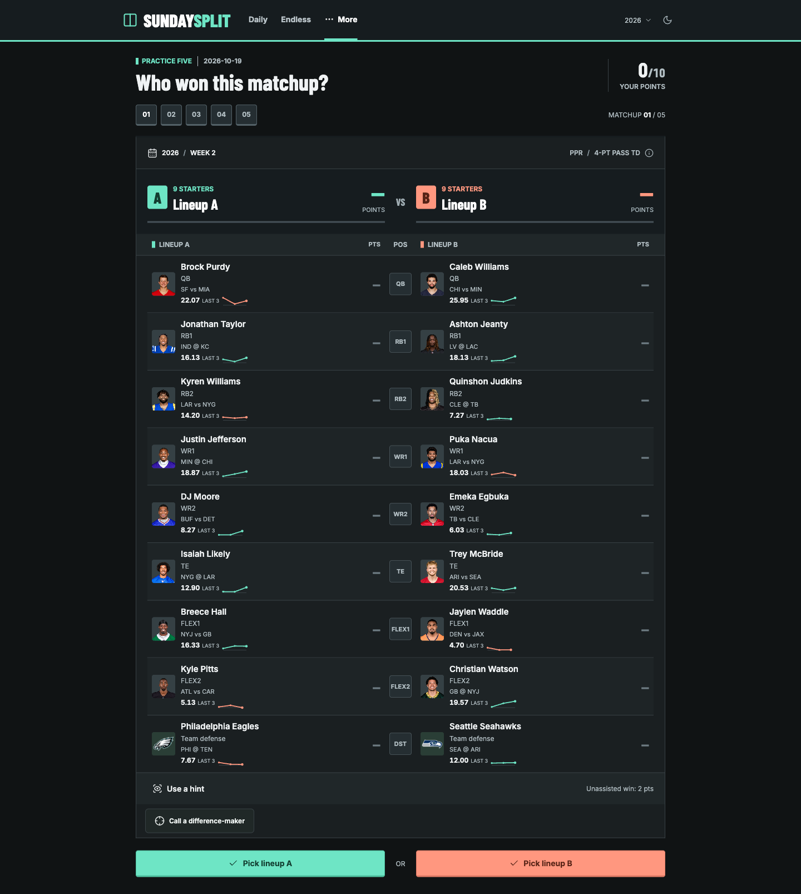

# Sunday Split

**You know ball? Prove it.**

A daily fantasy-football guessing game built from real, completed Sleeper matchups. Compare two starting lineups, pick the winner, then watch the actual points come in. Five matchups. Five calls.

[Play Sunday Split](https://www.sundaysplit.app/) · [How to play](https://www.sundaysplit.app/how-it-works/) · [Engineering notes](docs/ENGINEERING_NOTES.md)



## The Game

Everyone receives the same Daily Five, refreshed by date in `America/Toronto`. Each round is a separate head-to-head matchup, not another attempt at the same question.

1. Compare the starters, league scoring, NFL opponents, and recent form.
2. Pick Lineup A or B. Optionally reveal the same starting slot on both sides as a hint.
3. Watch starter scores and team totals reveal by position.
4. Finish five rounds for a result out of five and a spoiler-free share.

Correct picks earn **2 points unassisted** or **1 with a hint**. The headline result counts winners picked, regardless of hints. Completed Daily games build a device-local streak.

## What Makes It Interesting

- **Clues without hindsight.** Last-three-game averages use only appearances before the hidden matchup, scored using that league's settings.
- **Anti-spoiler daily selection.** Packs prioritize avoiding repeated player-season-week performances across both lineups, then balance weeks, margins, and dramatic score swings.
- **Real lineups and scoring.** Imported starter totals are validated; ties, adjusted scores, incomplete lineups, and unsupported formats are excluded.
- **A short daily session, more when you want it.** Daily and Endless stay in the main navigation. Extra modes and shared tools live under More or postgame disclosures.
- **A reveal built for phones.** Position-by-position totals, automatic reveal scrolling, faster Endless playback, skip controls, and reduced-motion support.
- **Social play with honest numbers.** Exact-set links, league standings, real community votes, and no fabricated consensus.

## Modes & Shared Play

| Mode | Experience |
| --- | --- |
| Daily | The same five matchups for everyone on that date |
| Endless | Keep picking; track accuracy and a correct-pick streak |
| Practice | Another five, separate from Daily |
| Confidence | Spend values 1-5 once each; up to 15 points, no hints |
| Fourth Quarter | Banked scores visible, two offensive slots left to reveal |
| Blind Resume | Positions, opponents, and recent form; identities after the pick |

Fourth Quarter is a staged historical reveal, not an NFL-clock simulation.

Postgame tools include the Film Room, a device-local weekly recap, one-round Grudge Matches, five-round score challenges, named creator sets, league rivalries, and a community debrief. An optional difference-maker side call does not change the main score.

## Architecture

```text
Sleeper league matchups + historical player stats
                    |
                    v
Import -> validate -> enrich prior-game clues -> curate
                    |
          +---------+----------+
          |                    |
          v                    v
Static game assets      Compact score catalog
          |                    |
          v                    v
Browser game             Worker API
Local saves              Anonymous sessions
Streaks + recap          Room scoring + votes
                               |
                               v
                          D1 / SQLite
```

The frontend is vanilla JavaScript, HTML, and CSS. Production runs as an ESM Worker on Sites with a D1 database. The local development server uses Node.js and SQLite. An alternative Cloudflare deployment configuration is also included.

The build embeds compressed static assets and a compact authoritative score catalog. Room submissions are scored against frozen server snapshots rather than client-supplied point totals.

## Run Locally

Use **Node.js 22.13+**; the local server uses `node:sqlite`.

```sh
git clone https://github.com/gmnothi/sunday-split.git
cd sunday-split
npm ci
npm start
```

Open [127.0.0.1:4317](http://127.0.0.1:4317/). No API key or production database credentials are needed for the checked-in game pool.

Local shared-play data is stored in the ignored `.sites-runtime/social.sqlite` file, separate from production.

## Checks

```sh
npm run check          # Data, scoring, clues, selection, saved-game regressions
npm run check:social   # Shared links, rooms, votes, bonus modes, privacy controls
npm run build         # Production Worker and static asset bundle
npm run check:sites   # Bundle integrity, routes, cache handling, generated schema
```

The diversity suite tests 600 seeded packs across both seasons, plus sparse-pool fallback and saved-set restoration. Browser QA scripts in `scripts/qa-*.js` cover mobile layouts, themes, hints, reveal timing, and multi-browser shared play.

## Data Pipeline

The checked-in snapshot contains **2,292 matchups**: 1,429 from 2026 Weeks 1-5 and 863 from the 2025 archive. These are snapshot counts, not a promise of live or automatically refreshed coverage.

```sh
npm run refresh:pool -- --known-only
npm run refresh:clues
npm run curate:swings
npm run check
```

Refreshes only import completed weeks and preserve existing matchup records. New-pool snapshots protect earlier Daily selections. The data-refresh scripts access external Sleeper endpoints; some enrichment and image endpoints are undocumented and can change.

See [engineering notes](docs/ENGINEERING_NOTES.md) for detailed selection rules, refresh commands, deployment steps, schema history, and browser QA procedures.

## Project Layout

```text
dist/        Browser source, game data, clues, and static information pages
server/      Worker API, local SQLite adapter, build pipeline, portable migrations
db/          Drizzle schema
drizzle/     Production database migrations
scripts/     Importers, enrichment, curation, regression tests, browser QA
research/    Data-validation and curation reports
docs/        Project preview and deeper engineering notes
```

Despite its name, `dist/` contains the maintained static source. Generated Worker output is ignored under `dist/server/`.

## Privacy & Boundaries

Daily progress, streaks, preferences, and weekly recaps stay in the browser. Shared rooms and votes use anonymous 30-day browser profiles, not verified accounts. Community percentages remain hidden below five submitted browser-profile picks.

Answers are delivered with the game assets. This is casual fan play, not an anti-cheat system or a prize competition. Recent form is a clue, not a projection; a dramatic historical finish is not a reconstructed betting upset.

## Attribution

Independent, fan-made project; not affiliated with the NFL, its teams, the NFL Players Association, or Sleeper. Matchups and historical clues use Sleeper data; headshots and team logos use Sleeper-hosted images. Third-party data and image rights are not granted by this repository. [Lucide](https://lucide.dev/) supplies the interface icons; see [third-party notices](docs/THIRD_PARTY_NOTICES.md).

[About the data](https://www.sundaysplit.app/about/#data) · [Privacy](https://www.sundaysplit.app/privacy/)
